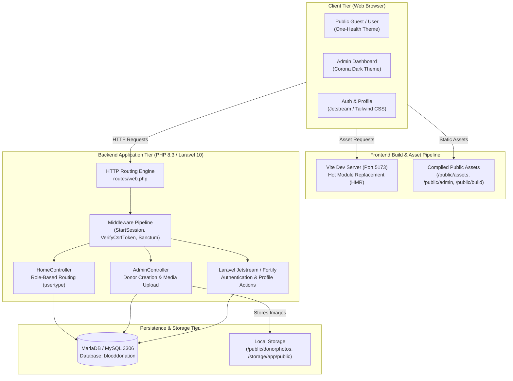

# Blood Donation Portal — System Workflows & Architecture Documentation

Welcome to the comprehensive architecture and workflow documentation for the **Laravel Blood Donation Portal**. This documentation details the design, data flows, lifecycles, and operational procedures across the frontend, backend, database, and system integration layers.

---

## 📑 Documentation Index

| Document | Scope & Focus | Description |
| :--- | :--- | :--- |
| **[1. Frontend Workflow](file:///D:/PROJECT_S/Laravel%20Blood%20Donation%20Portal/workflows/frontend-workflow.md)** | UI / UX / Client Layer | Blade view hierarchy, dual UI themes (Public & Admin), Vite asset bundling, Livewire, and component tree. |
| **[2. Backend Workflow](file:///D:/PROJECT_S/Laravel%20Blood%20Donation%20Portal/workflows/backend-workflow.md)** | Application & Server Layer | Laravel 10 MVC architecture, request lifecycles, role-based redirection, controllers, middleware, and file upload processing. |
| **[3. Database Workflow](file:///D:/PROJECT_S/Laravel%20Blood%20Donation%20Portal/workflows/database-workflow.md)** | Persistence & Storage Layer | MySQL schema, Entity-Relationship (ER) diagram, table dictionaries, migration pipelines, and Eloquent models. |
| **[4. System Integration Workflow](file:///D:/PROJECT_S/Laravel%20Blood%20Donation%20Portal/workflows/system-integration-workflow.md)** | End-to-End Workflows | Interactive sequence diagrams, end-to-end user journeys (donor browsing, registration, admin uploads), and runtime operations. |

---

## 🏛️ High-Level System Architecture

The Blood Donation Portal is built on a modern decoupled-yet-monolithic Laravel architecture combining server-rendered Blade templates, reactive Livewire components, Vite-managed assets, and a relational MySQL datastore.

---

## ⚙️ Environment and Port Mapping

| Service | Port | Host | Protocol | Responsibilities |
| :--- | :--- | :--- | :--- | :--- |
| **Laravel Artisan Backend** | `8000` | `127.0.0.1` | HTTP | Serves Blade views, REST endpoints, and manages sessions |
| **Vite Frontend Server** | `5173` | `localhost` | HTTP/WS | Provides HMR, compiles CSS/JS modules during development |
| **MariaDB / MySQL** | `3306` | `127.0.0.1` | TCP/MySQL | Stores users, donors, session records, and access tokens |
| **Media Storage** | Direct | `public/donorphotos` | File URI | Houses uploaded donor identification and profile photographs |

---

## 🚀 Quick Reference Commands

- **Start Database**: `C:\xampp\mysql\bin\mysqld.exe --defaults-file=C:\xampp\mysql\bin\my.ini --console`
- **Run Migrations**: `cd blooddonation; php artisan migrate`
- **Start Backend**: `cd blooddonation; php artisan serve --host=127.0.0.1 --port=8000`
- **Start Frontend**: `cd blooddonation; npm run dev`
- **Build Frontend for Production**: `cd blooddonation; npm run build`
