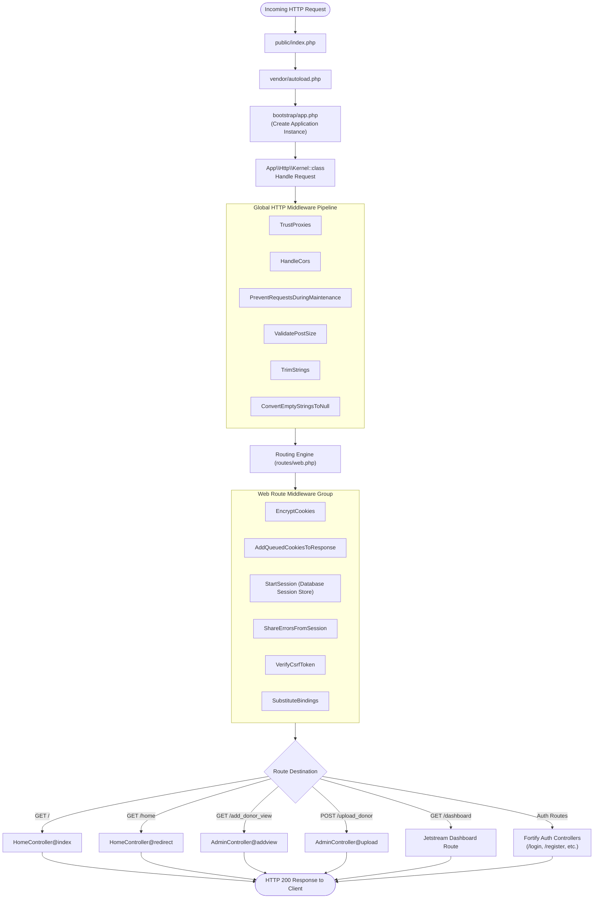
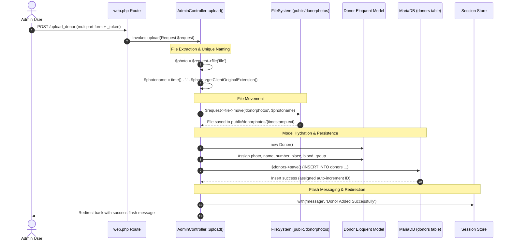

# ⚙️ Backend Architecture and Workflow

This document details the server-side architecture, HTTP request-response lifecycles, routing pipelines, controller operations, authentication guards, and file handling routines in the **Laravel Blood Donation Portal**.

---

## 1. Backend Technology Stack

- **Framework**: Laravel 10.13.5 (PHP ^8.1 / Running on PHP 8.3.33 ZTS).
- **Architecture Pattern**: Model-View-Controller (MVC) with Service Providers and Action Pipelines.
- **Authentication Core**: Laravel Fortify & Laravel Jetstream (v3.2) utilizing Sanctum (v3.2) stateful guard.
- **Database Access Layer**: Eloquent ORM (ActiveRecord pattern) on top of PDO MySQL.
- **Session & State Management**: Database-driven sessions stored in the `sessions` table.
- **Application Server**: Laravel Artisan CLI Built-in Server (`php artisan serve`).

---

## 2. HTTP Request-Response Lifecycle

Every incoming request follows a strict pipeline through Laravel's HTTP Kernel:



---

## 3. Route Map and Access Controls

Defined within [routes/web.php](file:///D:/PROJECT_S/Laravel%20Blood%20Donation%20Portal/blooddonation/routes/web.php):

| Method | URI | Action / Handler | Middleware | Security / Access |
| :--- | :--- | :--- | :--- | :--- |
| `GET` | `/` | `HomeController@index` | `web` | Public (Guests & Authenticated users) |
| `GET` | `/home` | `HomeController@redirect` | `web` | Authenticated users (checks `usertype`) |
| `GET` | `/dashboard` | Closure -> `view('dashboard')` | `web`, `auth:sanctum`, `jetstream.auth_session`, `verified` | Authenticated & Verified users |
| `GET` | `/add_donor_view` | `AdminController@addview` | `web` | Admin donor creation form |
| `POST` | `/upload_donor` | `AdminController@upload` | `web`, `VerifyCsrfToken` | Multipart upload and DB save |
| `GET` | `/login` | `Laravel\Fortify\Http\Controllers\AuthenticatedSessionController@create` | `web`, `guest` | Unauthenticated visitors |
| `POST` | `/login` | `Laravel\Fortify\Http\Controllers\AuthenticatedSessionController@store` | `web`, `guest` | Rate-limited credential validation |
| `GET` | `/register` | `Laravel\Fortify\Http\Controllers\RegisteredUserController@create` | `web`, `guest` | Registration form |
| `POST` | `/register` | `Laravel\Fortify\Http\Controllers\RegisteredUserController@store` | `web`, `guest` | User creation action pipeline |

---

## 4. Controller Workflows

### 4.1 `HomeController` Logic Workflow

Responsible for role-based branching between the regular user portal and the administrator dashboard:

```mermaid
flowchart TD
    ReqHome([Request to / or /home]) --> CheckEndpoint{Which Endpoint?}
    
    %% Handling GET /
    CheckEndpoint -->|GET /| CheckAuthRoot{Auth::id() Present?}
    CheckAuthRoot -- Yes --> RedirectHome[Redirect to /home]
    CheckAuthRoot -- No --> QueryDonorsRoot["Query DB: Donor::all()"]
    QueryDonorsRoot --> RenderUserHomeRoot["Render view('user.home', compact('donors'))"]

    %% Handling GET /home
    CheckEndpoint -->|GET /home| CheckAuthHome{Auth::id() Present?}
    CheckAuthHome -- No --> RedirectBack[Redirect Back]
    CheckAuthHome -- Yes --> CheckRole{Auth::user()->usertype == '0'}
    
    CheckRole -- Yes (Regular User: 0) --> QueryDonorsUser["Query DB: Donor::all()"]
    QueryDonorsUser --> RenderUserHome["Render view('user.home', compact('donors'))"]
    
    CheckRole -- No (Admin: 1 or other) --> RenderAdminHome["Render view('admin.home')"]
```

### 4.2 `AdminController` File Upload and Persistence Workflow

Located at [AdminController.php](file:///D:/PROJECT_S/Laravel%20Blood%20Donation%20Portal/blooddonation/app/Http/Controllers/AdminController.php):



---

## 5. Security and Middleware Safeguards

1. **CSRF Protection (`VerifyCsrfToken`)**:
   - All `POST` forms (including `/upload_donor`, Fortify `/login`, `/register`, and `/logout`) require the `@csrf` Blade directive which outputs a hidden `_token` verified against the user's active session.
   - Any attempt to trigger logout or state changes via `GET` is blocked; logout is strictly bound to `POST /logout` with valid session CSRF tokens across desktop docks, mobile drawers, and user drop-downs.
2. **Database Sessions (`StartSession`)**:
   - Session identifiers are persisted in the `sessions` table in MariaDB, preventing session hijacking and providing cross-request state preservation.
3. **Jetstream / Sanctum Authentication Guards**:
   - Manages cookie-based session tokens with strict expiration and optional two-factor authentication recovery pipelines.
4. **Role-Based Access Control (RBAC) & Defense-in-Depth**:
   - **Regular Users (`usertype == '0'`)**: Routed via `HomeController@redirect` to the Volunteer Donor Hub (`user.home` and `/dashboard`). Restricted from administrative donor intake operations.
   - **Administrators (`usertype != '0'`)**: Routed via `HomeController@redirect` to the VitaDrop Global Command Center (`admin.home`). Granted access to the Donor Intake Terminal (`/add_donor_view`).
   - **Blade Authorization Shields**: `admin/home.blade.php` and `admin/add_donor.blade.php` implement client-side authorization shields preventing unauthenticated visitors and non-admin users from accessing coordinator controls.
5. **Mass Assignment Prevention**:
   - User registration safely guards attributes via the `$fillable` array defined in [`User.php`](file:///D:/PROJECT_S/Laravel%20Blood%20Donation%20Portal/blooddonation/app/Models/User.php#L26-L32).
