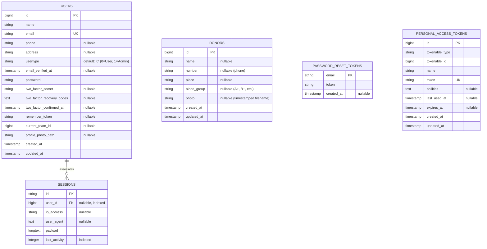
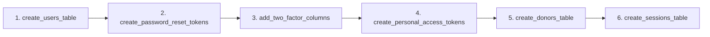
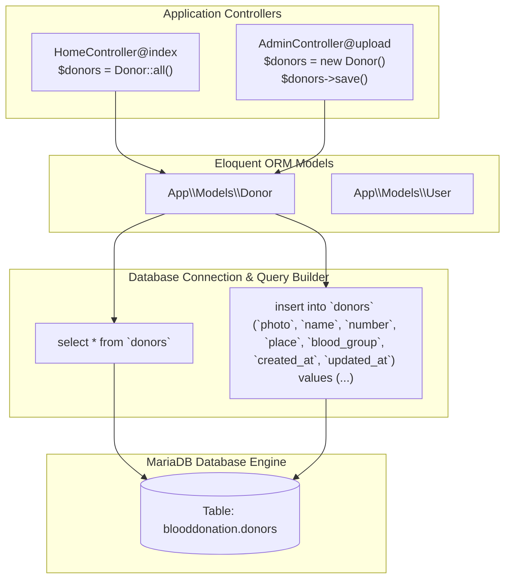

# 🗄️ Database Architecture and Workflow

This document provides a comprehensive analysis of the database schema, entity relationships, migration pipelines, data dictionaries, and Eloquent ORM data access layers in the **Blood Donation Portal**.

---

## 1. Database Specifications

| Parameter | Specification |
| :--- | :--- |
| **RDBMS Engine** | MariaDB 10.4.32 / MySQL Compatible |
| **Port / Host** | `127.0.0.1:3306` |
| **Target Database** | `blooddonation` |
| **Character Set** | `utf8mb4` |
| **Collation** | `utf8mb4_unicode_ci` |
| **Session Persistence** | Database table (`sessions`) |
| **Access Driver** | PDO MySQL (`DB_CONNECTION=mysql`) |

---

## 2. Entity-Relationship (ER) Diagram



---

## 3. Detailed Data Dictionary

### 3.1 `users` Table
Stores authentication credentials, user profiles, and administrative privilege roles.

| Column | Type | Nullable | Default | Description |
| :--- | :--- | :--- | :--- | :--- |
| `id` | `BIGINT UNSIGNED` | No | Auto Increment | Primary identifier for each user |
| `name` | `VARCHAR(255)` | No | None | Full legal name |
| `email` | `VARCHAR(255)` | No | None | Unique login address |
| `phone` | `VARCHAR(255)` | Yes | `NULL` | User's telephone contact |
| `address` | `VARCHAR(255)` | Yes | `NULL` | Residential address or locality |
| `usertype` | `VARCHAR(255)` | No | `'0'` | Role indicator: `'0'` = Regular User, `'1'` = Admin |
| `email_verified_at` | `TIMESTAMP` | Yes | `NULL` | Email verification timestamp |
| `password` | `VARCHAR(255)` | No | None | Bcrypt-hashed password |
| `two_factor_secret` | `TEXT` | Yes | `NULL` | Encrypted 2FA secret |
| `two_factor_recovery_codes` | `TEXT` | Yes | `NULL` | 2FA emergency backup tokens |
| `remember_token` | `VARCHAR(100)` | Yes | `NULL` | Token for "Remember Me" sessions |
| `current_team_id` | `BIGINT UNSIGNED` | Yes | `NULL` | Jetstream team reference (if enabled) |
| `profile_photo_path` | `VARCHAR(2048)` | Yes | `NULL` | Path to avatar image |
| `created_at` / `updated_at` | `TIMESTAMP` | Yes | `NULL` | Standard Eloquent timestamps |

---

### 3.2 `donors` Table
Stores blood donor profiles displayed on the public registry.

| Column | Type | Nullable | Default | Description |
| :--- | :--- | :--- | :--- | :--- |
| `id` | `BIGINT UNSIGNED` | No | Auto Increment | Primary identifier for each donor |
| `name` | `VARCHAR(255)` | Yes | `NULL` | Donor's full name |
| `number` | `VARCHAR(255)` | Yes | `NULL` | Contact phone number for calls & WhatsApp |
| `place` | `VARCHAR(255)` | Yes | `NULL` | Location / City / Blood camp area |
| `blood_group` | `VARCHAR(255)` | Yes | `NULL` | Blood category (e.g. "A Positive", "O Negative") |
| `photo` | `VARCHAR(255)` | Yes | `NULL` | Filename of uploaded image in `public/donorphotos/` |
| `created_at` / `updated_at` | `TIMESTAMP` | Yes | `NULL` | Standard Eloquent timestamps |

---

### 3.3 `sessions` Table
Manages active user state, flash data, and authentication tokens across browser requests.

| Column | Type | Nullable | Default | Description |
| :--- | :--- | :--- | :--- | :--- |
| `id` | `VARCHAR(255)` | No | None | Primary session UUID token |
| `user_id` | `BIGINT UNSIGNED` | Yes | `NULL` | Foreign key referencing `users.id` |
| `ip_address` | `VARCHAR(45)` | Yes | `NULL` | Client IPv4 or IPv6 address |
| `user_agent` | `TEXT` | Yes | `NULL` | Browser User-Agent header string |
| `payload` | `LONGTEXT` | No | None | Serialized session data & flash variables |
| `last_activity` | `INT` | No | None | UNIX timestamp for session garbage collection |

---

## 4. Migration Execution Pipeline

Laravel manages the schema versioning via timestamped migration files located in `blooddonation/database/migrations/`:



### 4.1 Migration Management Commands
- **Run Pending Migrations**:
  ```powershell
  cd blooddonation
  php artisan migrate
  ```
- **Check Migration Status**:
  ```powershell
  php artisan migrate:status
  ```
- **Rollback Last Migration Batch**:
  ```powershell
  php artisan migrate:rollback
  ```

---

## 5. Eloquent ORM Data Access Flow


