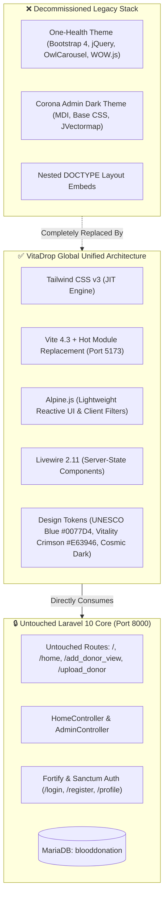

# 🎨 VitaDrop Global: Frontend Architecture & UI Design System
### *A UNESCO Humanitarian Blood Initiative Presentation Tier Specification*

---

## 1. Architectural Overview & Legacy Replacement

The legacy presentation tier—formerly composed of conflicting CSS frameworks (**Bootstrap 4** vs. **Tailwind CSS**), outdated jQuery UI dependencies (**One-Health** and **Corona Admin**), and malformed nested `<!DOCTYPE>` embeds—has been completely decommissioned and replaced.

The application is rebranded as **"VitaDrop Global: A UNESCO Humanitarian Blood Initiative"**. The new frontend tier operates as a high-performance, unified, single-engine presentation layer built on:
- **Engine**: Tailwind CSS v3.1 + Alpine.js + Livewire 2.11 + Vite 4.3.
- **Backend Decoupling**: Completely decoupled from Laravel controller code. Directly consumes untouched routes (`/`, `/home`, `/add_donor_view`, `/upload_donor`) and Fortify/Sanctum authentication pipelines.
- **Aesthetic**: Futuristic glassmorphism, subtle mesh backdrops, clinical UNESCO Blue (`#0077D4`), arterial Vitality Crimson (`#E63946`), and sterile white contrasts.



---

## 2. Visual Design System Specifications

### 2.1 Color Palette & Semantic Tokens

```
+---------------------------------------------------------------------------------+
| PRIMARY: UNESCO Blue          | ACCENT: Vitality Crimson  | NEUTRAL: Cosmic Dark|
| #0077D4                       | #E63946                   | #0B132B / #050B17   |
| Authority, Security, Trust    | Life, Arterial Emergency  | Command Shell       |
+-------------------------------+---------------------------+---------------------+
| STERILE WHITE: #FFFFFF (85%)  | MESH GLOW: rgba(0,119,212)| BORDER: White/80    |
+---------------------------------------------------------------------------------+
```

- **UNESCO Blue (`#0077D4`)**: Brand anchor. Used for primary CTAs, institutional badges, geolocation markers, and navigational accents.
- **Vitality Crimson (`#E63946`)**: High-priority arterial action color. Used for blood group indicators, emergency radar pulse effects, and critical status badges.
- **Sterile White (`#FFFFFF`)**: Crisp, modern clinical surfaces with soft diffusion.
- **Cosmic Dark (`#0B132B` to `#050B17`)**: Deep telemetry bars and admin command center chassis.

### 2.2 Glassmorphism & Mesh Backdrop Engine
- **Backdrop Filters**: `backdrop-filter: blur(16px)` with `-webkit-backdrop-filter: blur(16px)`.
- **Panel Translucency**: `rgba(255, 255, 255, 0.75)` to `rgba(255, 255, 255, 0.85)`.
- **Subtle Mesh Radial Gradients**: Dynamic multi-point radial gradients generating soft chromatic depth without layout shifts.
- **Specular Border Highlights**: `1px solid rgba(255, 255, 255, 0.8)` creating clean frosted-edge refraction.

---

## 3. Presentation View Architecture

### 3.1 Public Presentation Layer (`resources/views/user/`)
- **`user/home.blade.php`**:
  - Global humanitarian telemetry bar with live dispatch hotline (`+91 9744701363`).
  - Floating frosted navigation dock with responsive mobile drawer.
  - High-impact hero section with real-time humanitarian metrics deck.
  - UNESCO Humanitarian Protocol pillars (Direct P2P, Immediate Routing, Regional Command Registry).
  - Modern humanitarian footer with grid telemetry identifiers.
- **`user/donors.blade.php`**:
  - Embedded reactive search & filter bar powered by **Alpine.js**.
  - Client-side instantaneous filtering by donor name, city/place, or blood group without extra HTTP requests.
  - Glass donor cards with dynamic photo fallback, glowing blood group badges, and one-click direct dialing (`tel:`) and encrypted WhatsApp coordination.

### 3.2 Command Operations Layer (`resources/views/admin/`)
- **`admin/home.blade.php`**:
  - Replaces Corona Admin with the **VitaDrop Global Command Center**.
  - Real-time operational telemetry grid (Registry status, response SLA, active protocol, session security).
  - Quick action links to the Donor Intake Terminal and Live Public Grid.
- **`admin/add_donor.blade.php`**:
  - Futuristic clinical donor intake terminal.
  - Consumes untouched `POST /upload_donor` endpoint with multipart image streaming.
  - Interactive drag-and-drop file upload zone with real-time thumbnail preview using Alpine.js (`FileReader` API).
  - Dismissible glowing success banner bound to `session('message')`.

### 3.3 Authentication & Profile Layer (`resources/views/auth/` & `layouts/`)
- **`layouts/guest.blade.php`**:
  - Ambient glow orbs with glassmorphic authentication cards.
  - Unified [`x-vitadrop-logo`](file:///D:/PROJECT_S/Laravel%20Blood%20Donation%20Portal/blooddonation/resources/views/components/vitadrop-logo.blade.php) brand emblem.
- **`layouts/app.blade.php`**:
  - Clean authenticated shell for Jetstream profile and session management.
