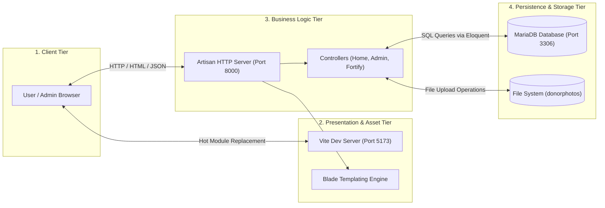
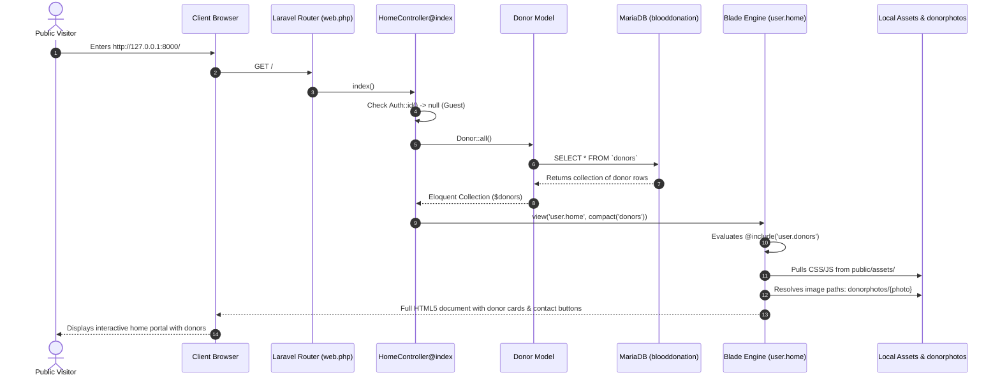
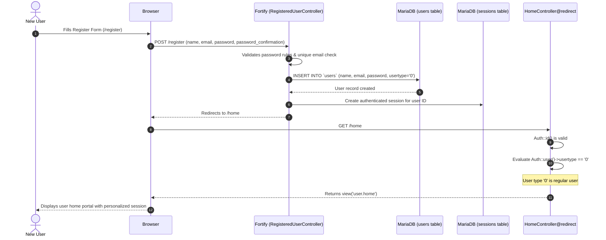
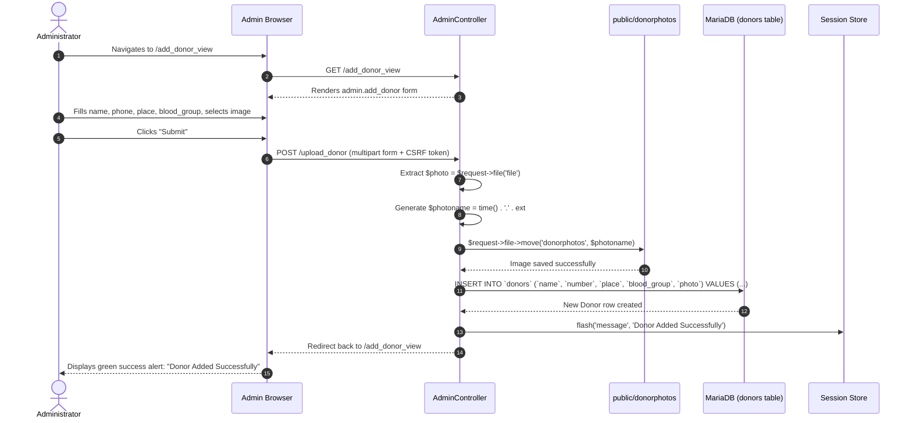
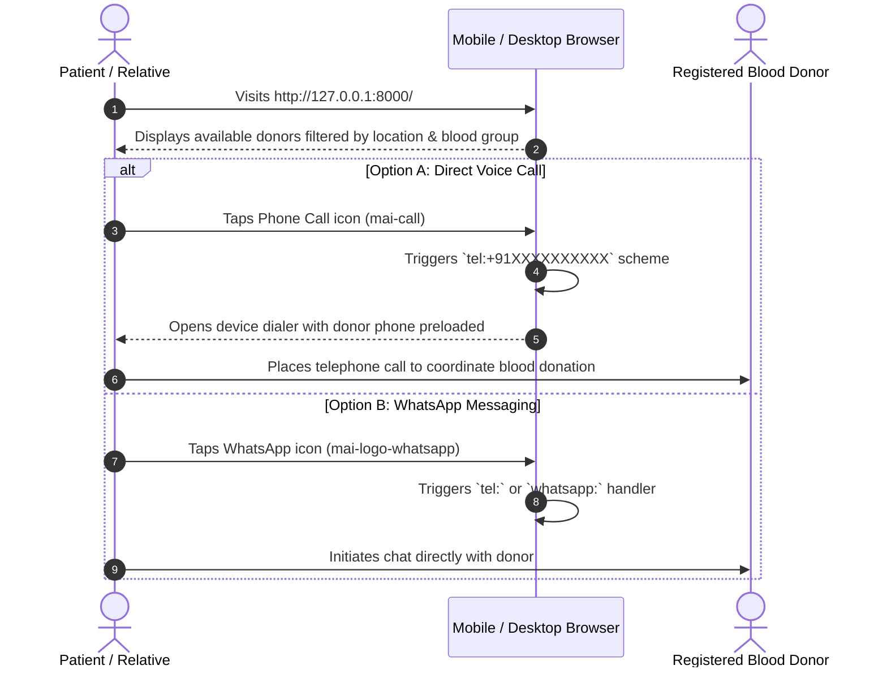

# 🔄 System Integration and End-to-End Workflows

This document integrates the frontend, backend, and database components into cohesive end-to-end workflow diagrams, showing the exact lifecycle of data and control flow across the entire Blood Donation Portal.

---

## 1. System Integration Overview

The system operates across four coordinated runtime boundaries:



---

## 2. End-to-End Sequence Diagrams

### 2.1 Workflow 1: Public Visitor Homepage & Donor Listing



---

### 2.2 Workflow 2: User Registration & Role-Based Redirection



---

### 2.3 Workflow 3: Administrator Donor Registration with Image Upload



---

### 2.4 Workflow 4: Emergency Blood Request Interaction



---

## 3. Runtime Orchestration and Process Health

The application runs via three concurrently managed processes:

```mermaid
stateDiagram-v2
    [*] --> StartingServices
    
    state StartingServices {
        MySQL : Port 3306 (MariaDB Engine)
        Artisan : Port 8000 (Laravel PHP Server)
        Vite : Port 5173 (Node.js Dev Server)
    }

    StartingServices --> Operational : All Ports Listening

    state Operational {
        state "Incoming Web Traffic" as Traffic
        Traffic --> Artisan : HTTP GET / POST
        Artisan --> MySQL : SQL Query Execution
        Artisan --> Vite : Asset Resolution & Script Injection
    }

    Operational --> [*] : Server Shutdown
```

### Process Verification Checklist
- **MySQL Engine**: `Test-NetConnection -ComputerName 127.0.0.1 -Port 3306` (TCP Succeeded: `True`)
- **Laravel Backend**: `Invoke-WebRequest -Uri "http://127.0.0.1:8000/"` (Status: `200 OK`)
- **Vite Asset Server**: `Invoke-WebRequest -Uri "http://localhost:5173/@vite/client"` (Status: `200 OK`)
- **Uploaded Photos Directory**: `public/donorphotos` (Read/Write permitted)
